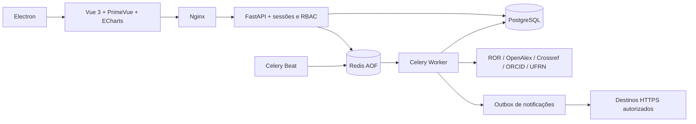

# Arquitetura

Para a referência atual e detalhada do servidor Python, consulte o [guia do backend](backend/README.md) e o [mapa de módulos e dados](backend/architecture.md). Esta página mantém a visão geral do sistema completo.

## Responsabilidades

- `main.py` e `security.py`: autenticação, sessões, permissões, CSRF e contexto de requisição.
- `read_api.py` / `write_api.py`: consultas e comandos HTTP; validação de entrada em `schemas.py`.
- `operations.py`: orquestração das coletas, transações, contadores e integridade.
- `providers.py`: adaptadores HTTP com timeout, limites, retentativas e validação contratual.
- `automation.py`: regras, incidentes, eventos deduplicados e entregas duráveis.
- `tasks.py`: tarefas Celery, despacho e ciclo periódico.
- `domain.py`: modelo operacional; `models.py` preserva entidades da primeira versão.
- `migrations`: evolução versionada; nenhuma tabela anterior é apagada.
- `discovery.py` / `discovery_api.py`: consulta compartilhada entre filtros, exportação, facetas e avisos de pesquisas salvas.
- `search_index.py` / `discovery_models.py`: projeções de busca e relações normalizadas de temas, autores e afiliações; atualização na mesma transação dos dados de origem.

É um monólito modular. A mesma imagem Python executa API, worker e agendador com comandos distintos, evitando microserviços sem necessidade. Os adaptadores são substituíveis nos testes; não há um repositório genérico que apenas replique o SQLAlchemy.

## Identidade e origem

- Instituições: ROR ID.
- Trabalhos: OpenAlex ID; DOI normalizado para enriquecimento e sinalização de possíveis duplicatas.
- Pesquisadores: ORCID.
- Conjuntos: identificador CKAN.

Crossref complementa um trabalho existente, sem criar uma segunda publicação ou substituir o título recebido do OpenAlex. Metadados e horários de coleta são preservados por fonte. Uma divergência é sinalizada para revisão.

Temas usam o identificador externo. Autorias com ORCID compartilham a identidade canônica; autorias sem identificador ficam restritas à publicação/posição, evitando unir pessoas apenas pelo nome. O índice elimina acentos para busca e mantém os textos originais para exibição. Favoritos e pesquisas são sempre consultados pelo usuário da sessão.

## Navegação e pesquisa

Vue Router mantém rotas e filtros na URL. As requisições de pesquisa antigas são canceladas quando uma nova começa. A lista de sugestões tem seleção por teclado e estado ARIA; as ações nos gráficos possuem alternativas em texto. Os resultados mostram fonte e coleta, e distinguem informação ausente de ausência de produção.

O PostgreSQL utiliza índices GIN para texto e trigramas. As consultas parametrizadas dão prioridade a título exato/prefixo e também procuram termos em nomes alternativos, resumos e relacionamentos. SQLite aplica a mesma normalização de acentos, com correspondência textual. Não há mecanismo semântico ou tradução automática dos temas.

## Integridade e concorrência

`Run.active_key` é único por fonte e existe somente enquanto uma execução está pendente/ativa. A transição queued → running é condicional no banco. Dados e conclusão da coleta são confirmados na mesma transação. Erros de contrato interrompem a aplicação das alterações; a falha fica registrada separadamente.

Eventos possuem chave de deduplicação. As entregas são únicas por evento/destino e reivindicadas atomicamente. Webhooks são pelo menos uma vez: confirmação perdida pode causar reenvio, portanto o destinatário precisa usar a chave de idempotência.

O histórico da primeira versão foi mantido em sua tabela original, com endpoint de leitura. As migrações são aplicadas pela API antes de liberar a saúde exigida pelos workers.

## Observabilidade

Logs estruturados com request ID nas chamadas HTTP; execução/fonte nos eventos do worker. Cada coleta registra chamadas, retentativas, duração, novos/alterados/rejeitados, erros e cobertura. `/api/metrics` fornece métricas em formato Prometheus para administradores autenticados. Os tempos são de coleta completa, não somente latência de uma chamada externa.

O request ID oferece correlação por requisição; não é um sistema de tracing distribuído OpenTelemetry. Essa integração permanece uma evolução operacional possível.

## Referências oficiais

- [ROR — paginação](https://ror.readme.io/docs/api-paging)
- [OpenAlex — paginação e limites](https://help.openalex.org/api/paging/)
- [Crossref — REST API](https://www.crossref.org/documentation/retrieve-metadata/rest-api/)
- [ORCID — API pública](https://info.orcid.org/what-is-orcid/services/public-api/)
- [CKAN — Action API](https://docs.ckan.org/en/latest/api/)
- [FastAPI — Docker](https://fastapi.tiangolo.com/deployment/docker/)
- [Electron — segurança](https://www.electronjs.org/docs/latest/tutorial/security/)
