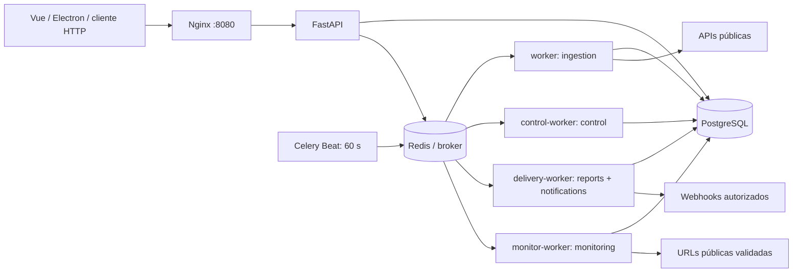
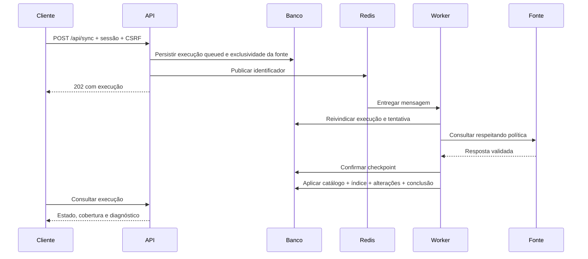

# Arquitetura e dados

## Visão de execução

É um monólito modular, com o mesmo código Python em serviços separados por função. Redis transporta mensagens; **o banco persiste intenções e estados operacionais**. A indisponibilidade temporária do broker não deve apagar uma solicitação confirmada no banco. Não há necessidade atual de separar os módulos em microserviços.

## Mapa do código

| Módulo | Responsabilidade |
| --- | --- |
| `main.py` | App, lifespan, middleware, saúde, autenticação e usuários |
| `security.py` | Hash, cookie de sessão, login e dependências viewer/operator/admin |
| `api_documentation.py` | Anotações OpenAPI a partir das dependências de acesso |
| `contracts.py`, `errors.py` | Contratos de resposta e erros com correlação, sem eco de corpos sensíveis |
| `reliability_api.py` | Resumos SQL limitados de cobertura e acompanhamento operacional |
| `account_api.py` | Troca de senha e gestão de sessões da própria conta |
| `schemas.py` | Modelos de entrada operacionais e validação de limites |
| `read_api.py`, `write_api.py` | Consultas e comandos de integração/operação |
| `catalog_api.py` | Filtros institucionais e cobertura dos metadados |
| `discovery_api.py` | Pesquisa, publicação, CSV, favoritos, pesquisas salvas e avisos |
| `discovery.py`, `search_index.py`, `metadata.py` | Critérios compartilhados, índice normalizado e apresentação bibliográfica |
| `operations.py`, `collector.py`, `job_runtime.py` | Execução de coletas, aplicação transacional, quotas, checkpoints e autorização da tentativa |
| `providers.py`, `connectors.py` | Adaptadores e transformação das respostas externas |
| `orchestration.py`, `orchestration_api.py` | Fluxos encadeados e comandos HTTP de controle |
| `calendar_jobs.py`, `automation_tick.py` | Calendários, avanço de fluxos e recuperação periódica |
| `automation.py`, `rule_preview.py` | Regras, eventos, incidentes, outbox e prévia |
| `reports.py` | Geração, retenção e acesso a relatórios privados |
| `monitor_inventory.py` | Descoberta e vínculo de URLs existentes no catálogo |
| `monitor_network.py` | DNS público, conexão ao IP validado, TLS, redirecionamentos e leitura limitada |
| `monitor_service.py`, `monitor_api.py` | Agendamento/verificação de links, histórico e API |
| `tasks.py` | Registro de tarefas Celery, filas e ciclo de controle |
| `database.py`, `migrate.py` | Engine, sessões SQLAlchemy e Alembic |
| `models.py`, `domain.py`, `*_models.py` | Modelos persistidos de catálogo, acesso e operação |

Os handlers ainda abrem sessões e contêm algumas regras de aplicação. Portanto, a arquitetura não é uma implementação estrita de Clean Architecture/DDD: há acoplamento explícito ao SQLAlchemy e ao FastAPI. Preferimos serviços com responsabilidades concretas a interfaces e repositórios genéricos que só duplicariam o ORM. Extrair serviços deve acompanhar complexidade real e testes de comportamento.

## Caminho de uma coleta

Publicação no broker e commit do banco não formam uma transação distribuída. O ciclo de controle republica intenções persistidas; transições condicionais e chaves únicas tornam mensagens repetidas seguras nos cenários cobertos pelos testes. Isso não promete entrega exatamente uma vez para efeitos externos.

## Persistência e identidade

| Domínio | Identidade / regra |
| --- | --- |
| Instituição | ROR ID; organizações de pesquisa não são necessariamente universidades |
| Publicação | OpenAlex ID; DOI normalizado serve ao enriquecimento e diagnóstico de duplicidade |
| Pesquisador | ORCID quando disponível; pessoas não são fundidas apenas por nome |
| Autoria sem ORCID | Identidade restrita à publicação e posição |
| Conjunto de dados | Identificador CKAN |
| Favorito / pesquisa / aviso / relatório | Vinculado ao usuário autenticado |
| Monitor | URL normalizada, com referências aos registros que a utilizam |

Respostas originais e metadados por fonte são preservados. Crossref enriquece uma publicação existente e não cria uma cópia independente do trabalho. `metadata.py` escolhe campos legíveis com fallback; os valores ausentes permanecem desconhecidos. Projeções e relações de pesquisa são atualizadas na mesma transação dos dados aplicados.

O inventário completo das tabelas está na [referência](reference.md); colunas, tipos, chaves e índices estão no [dicionário de dados](data-dictionary.md). A cardinalidade das entidades e constraints deve ser consultada nos modelos e migrações, sem confundir uma relação lógica com uma FK física.

## Busca

O catálogo usa projeções sem acentos, identificadores normalizados e relações de temas, autorias e afiliações. PostgreSQL possui índices GIN/pg_trgm e tolerância opcional a erros; SQLite mantém correspondência textual normalizada. A aproximação não altera a correspondência exata de identificadores. Não há busca semântica, tradução de temas ou consulta externa a cada digitação.

Resultados, facetas, CSV, pesquisas salvas, avisos e relatórios reutilizam critérios de `PublicationFilters`. Booleanos opcionais preservam três estados. Dados da biblioteca pessoal são filtrados pela identidade do servidor, sem confiar em um user ID enviado pelo navegador.

## Concorrência e transações

- Uma chave ativa única reserva cada fonte enquanto a execução está pendente/ativa, inclusive quando pausada.
- A reivindicação de `queued` para `running` é condicional no banco.
- Heartbeat, lease e identidade da tentativa impedem a aplicação de respostas atrasadas de tentativas substituídas.
- Pausa e cancelamento são cooperativos entre chamadas. Não interrompem uma transação no meio nem desfazem dados de etapas anteriores.
- Checkpoints guardam respostas confirmadas e seleção; não guardam tokens ou cabeçalhos de autenticação.
- Eventos e entregas têm chaves de deduplicação. Destinatários externos também devem deduplicar por idempotência.
- O monitor reivindica verificações atomicamente e não transforma adiamento por quota em indisponibilidade.

## Migrações

| Revisão | Evolução |
| --- | --- |
| `0001` | Estrutura operacional e preservação das entidades legadas |
| `0002` | Início das execuções |
| `0003` | Registro de consulta Crossref |
| `0004` | Descoberta, relações e índice de pesquisa |
| `0005` | Orquestração, políticas, checkpoints, calendários e relatórios |
| `0006` | Precisão bibliográfica e reindexação dos dados armazenados |
| `0007` | Inventário, verificações e configuração de monitoramento |

O startup aplica `upgrade head`; os testes verificam idempotência e preservação de registros legados. A versão 0.7 de UX não exigiu nova migração. Nunca altere uma migração aplicada para mudar o schema de ambientes existentes: crie a próxima revisão. Nem toda migração oferece downgrade destrutivo seguro; mantenha backup e valide restauração.

## Limites arquiteturais atuais

Alguns agregados de qualidade/perfis são calculados em memória; grandes volumes exigem agregação SQL/materialização e medição de desempenho. Request IDs e logs não equivalem a tracing distribuído. `/api/health` não verifica saúde das filas ou dos provedores. Ainda não há SSO, MFA, redefinição por e-mail, resposta tipada completa para todos os endpoints ou configuração pronta de alta disponibilidade. São limites explícitos, não funcionalidades implícitas da stack.
